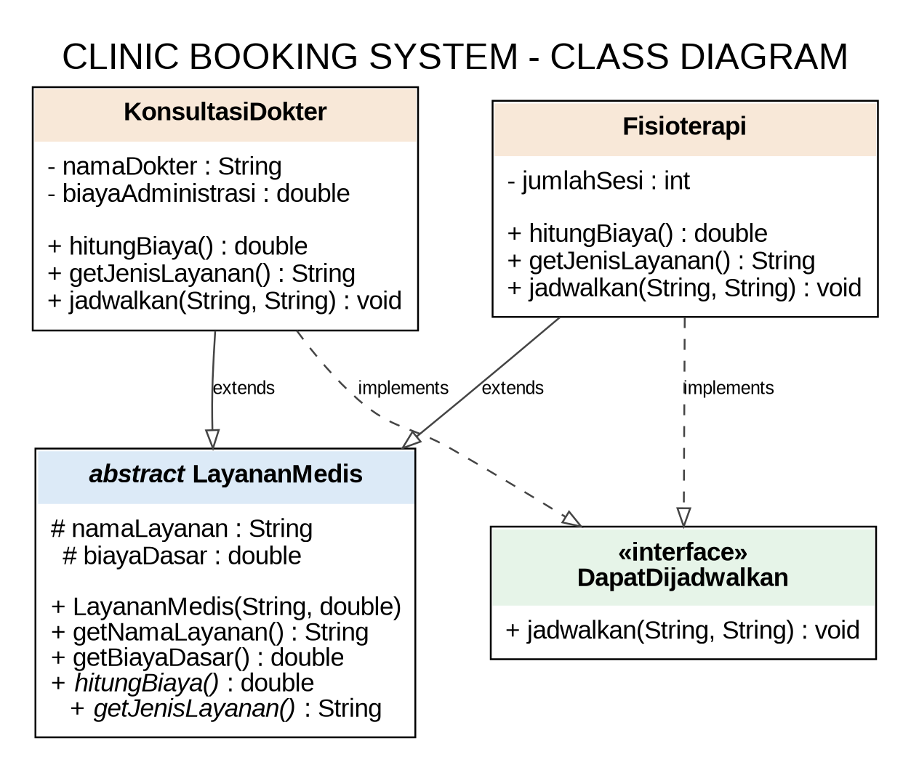

# Clinic Booking System (Java OOP)

A small console-based clinic booking example for reviewing **abstract classes, interfaces, inheritance, and polymorphism**. The case study is a familiar real-life situation: patients choose a clinic service, see its estimated fee, and schedule an appointment.

## Features
- Display available clinic services and estimated costs.
- Book a consultation or physiotherapy session.
- Basic input validation.
- Uses an `ArrayList` to store different service objects through one parent type.

## Project structure
```text
KlinikBookingSystem/
├── README.md
├── class-diagram.png
└── src/
    ├── DapatDijadwalkan.java
    ├── Fisioterapi.java
    ├── KonsultasiDokter.java
    ├── LayananMedis.java
    └── Main.java
```

## Important OOP concepts

### 1. Abstract class
`LayananMedis` is declared with `abstract`. It stores shared state (`namaLayanan` and `biayaDasar`) and provides getters. It also declares abstract methods `hitungBiaya()` and `getJenisLayanan()`, which concrete subclasses must implement. Because it represents a general service, it is not instantiated directly.

### 2. Abstract methods
`hitungBiaya()` and `getJenisLayanan()` have declarations but no method bodies in `LayananMedis`. Each concrete service supplies its own implementation.

### 3. Interface
`DapatDijadwalkan` defines the `jadwalkan(namaPasien, waktu)` contract. Classes that implement it promise to provide booking behavior. The interface describes a capability (“can be scheduled”), while the abstract class describes a shared “is-a” relationship.

### 4. Inheritance
`KonsultasiDokter` and `Fisioterapi` use `extends LayananMedis` to inherit shared attributes and methods. The `super(...)` call initializes the parent-class fields. Java allows a class to extend only one class, but it can implement multiple interfaces.

### 5. Interface implementation
Both service classes use `implements DapatDijadwalkan` and implement `jadwalkan(...)` as a `public` method, as required by interface methods.

### 6. Polymorphism
`ArrayList<LayananMedis>` stores both `KonsultasiDokter` and `Fisioterapi`. In the loop, `layanan.hitungBiaya()` is called through a `LayananMedis` reference. Java chooses the overridden method based on the actual object at runtime:
- Consultation: fixed base fee + administration fee.
- Physiotherapy: base fee × number of sessions.

The booking example also uses the `DapatDijadwalkan` interface as a reference type, illustrating programming to a contract.

### 7. Constructor and `super`
Constructors initialize each service. `super("Konsultasi Dokter", 150000)` and `super("Fisioterapi", 100000)` call the abstract parent's constructor.

### 8. ArrayList
`ArrayList<LayananMedis>` is a resizable collection. It allows the application to add different concrete service objects without maintaining separate lists for each service type.

## Class diagram
